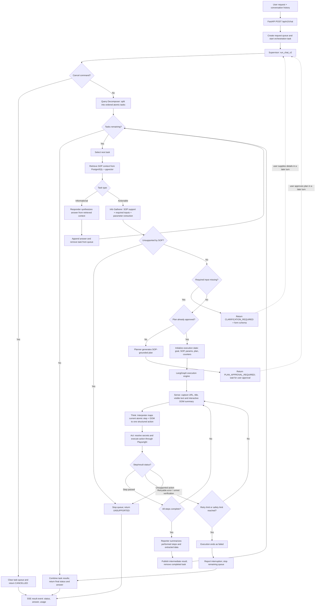

# Universal UI Automation Agents — Functional and Technical Architecture

**Repository view:** Current `backend_v2` execution path  
**Purpose:** Describe how a request moves from orchestration to a completed response, with the browser execution loop as the core of the architecture.

## 1. Overview

The system accepts a natural language request, breaks it into ordered tasks, retrieves relevant SOP material, and decides whether each task is informational or requires a UI action. For an action, it checks that the SOP supports the workflow and that required inputs are available. It then presents a plan for approval before using a Playwright-controlled browser to carry out the task. The browser agent repeatedly reads the current page, maps one atomic instruction to one UI action, performs it, and checks the resulting state. A reporter turns the execution state into a user-facing result.

The architecture is intended to be application-agnostic at the workflow level: procedures and application access details come from SOPs, while the execution engine uses the browser DOM and common interaction primitives. The current implementation is specifically a web-browser automation system; it is not a general desktop computer-use agent.

## 2. Request-to-completion flow



### 2.1 Orchestration and task isolation

1. The chat API accepts the request and prior messages, starts `run_chat_v2`, and streams log and terminal events over Server-Sent Events (SSE).
2. The Supervisor handles cancellation, recognizes a form-only follow-up or an approved-plan continuation, and otherwise invokes the Query Decomposer.
3. The decomposer produces ordered `INFORMATIONAL` and `ACTIONABLE` tasks. Distinct requested operations are represented as separate tasks and processed sequentially.
4. For each task, the Supervisor retrieves relevant SOP context. Action retrieval adds a login/authentication phrase to the search to find access prerequisites. Informational work is answered from the retrieved context by the Responder.
5. Actionable work passes through input and support validation. The Info Gatherer extracts parameters from the request and conversation, normalizes common field names, and identifies missing inputs. Missing inputs return `CLARIFICATION_REQUIRED`; unsupported procedures stop the queue.
6. If inputs are complete, the Planner generates a procedural plan grounded in the retrieved SOP. The first turn returns `PLAN_APPROVAL_REQUIRED`. After approval, the UI resends the request with the `/execute-approved-plan` marker, and the Supervisor reuses cached task and parameter context to proceed.

### 2.2 Browser execution loop

The Supervisor initializes a LangGraph state containing the task goal, SOP context, extracted parameters, approved plan, step and retry counters, and status. The graph executes the following loop:

1. **Plan:** Read the current browser URL/title and create a sequence of atomic UI instructions aligned to the approved plan. It can omit setup steps already satisfied by the current browser state.
2. **Sense:** Capture the page URL, title, visible text, and a summary of interactive DOM elements with labels and suggested selectors.
3. **Think:** The Interpreter receives exactly the current atomic instruction, the goal, explicit parameters, and sensed page state. It returns a structured action such as `navigate`, `click`, `fill`, `select`, `check`, `uncheck`, `verify_present`, `verify_not_present`, or `extract_data`.
4. **Act:** The executor normalizes selectors, resolves secret placeholders just in time, and invokes the matching Playwright operation through `BrowserManager`.
5. **Re-sense or stop:** A successful action advances the step index and returns to Sense. A failed action or unmet verification retries the same step. The graph stops on success, unsupported operation, retry exhaustion, or its safety step limit.
6. **Report:** The Reporter summarizes only the steps recorded as reached, includes extracted page data when present, and distinguishes confirmed success from interruption.

The main action types cover navigation, clicking, form filling, selecting dropdown values, checking/unchecking controls, presence/absence verification, short waits, and data extraction. The browser manager reuses a Playwright Chromium instance and can recover it if the browser or page is closed.

### 2.3 Completion and user response

After an actionable task, the Supervisor publishes an intermediate result, removes a successful task from the queue, and continues with the next task. A failed or unsupported task stops subsequent work. Once the queue is empty, the Supervisor combines task answers, adds a completion marker for a fully successful request, and returns a status, answer, and aggregate token usage. The API emits the result as the terminal SSE event. Other terminal outcomes include `CLARIFICATION_REQUIRED`, `PLAN_APPROVAL_REQUIRED`, `UNSUPPORTED`, `FAILED`, and `CANCELLED`.

## 3. Main runtime components

| Component | Role in the request lifecycle | Implementation |
|---|---|---|
| Chat API | Accepts query/history, starts orchestration, streams logs and result | FastAPI, `/api/v2/chat`, SSE |
| Supervisor | Decomposition, retrieval, task queue, clarification/approval gates, execution coordination, final response | `backend_v2/orchestrator/supervisor.py` |
| Query Decomposer | Converts a multi-part request into ordered information/action tasks | `backend_v2/agents/query_decomposer.py` |
| Retriever | Embeds a search phrase and ranks SOP content by vector similarity | OpenAI embeddings, PostgreSQL/pgvector; `backend_v2/rag/retriever.py` |
| Info Gatherer | Checks workflow support, extracts request parameters, asks for missing required fields | `backend_v2/agents/info_gatherer.py` |
| Planner | Builds the human-reviewable plan from goal and SOP context | `backend_v2/agents/planner.py` |
| Execution graph | Runs plan/sense/think/act cycle and controls retries and termination | LangGraph; `backend_v2/engine/execution_graph.py` |
| Interpreter | Maps one instruction and current DOM summary to one structured action | `backend_v2/agents/interpreter.py` |
| Browser Manager | Owns/reuses Chromium and exposes navigation, click, fill, select and UI-state methods | Playwright; `backend_v2/engine/browser_manager.py` |
| Secrets Manager | Resolves configured credential placeholders immediately before action and masks secrets in plans | `backend_v2/engine/secrets_manager.py` |
| Reporter / Responder | Summarizes UI outcomes or answers informational requests from SOP context | `backend_v2/agents/reporter.py`, `responder.py` |
| Knowledge store | Stores SOP documents and vectorized content for retrieval | PostgreSQL + pgvector; ingestion in `backend_v2/rag/ingestion.py` |

## 4. Knowledge and input flow

SOPs are ingested into the document store, embedded with `text-embedding-3-small`, and made searchable through pgvector. At runtime, the Supervisor creates a task-specific query, retrieves the highest-ranked content, and supplies that content to validation, planning, or informational response generation. The action workflow is designed to ground its steps in SOP material and to stop when the documented procedure is missing.

User-provided values are extracted into canonical parameters and carried into the execution graph. Sensitive values can be represented by placeholders such as `[APP_ADMIN_USERNAME]` and `[APP_ADMIN_PASSWORD]`; the Secrets Manager resolves these at action time. Plan output masks configured secrets. The Info Gatherer also masks values it classifies as sensitive when logging extracted parameters.

## 5. Benefits compared with scenario-specific RPA

Traditional RPA commonly requires a separately designed and maintained script for each application workflow or scenario. This system moves much of that scenario knowledge into a detailed SOP and uses language models to translate the SOP and user request into an execution plan and browser actions at runtime.

- **Less per-scenario development:** Add or update SOP knowledge to onboard workflows, instead of implementing a new fixed script for every scenario.
- **Reusable execution engine:** The same orchestration, DOM sensing, action interpretation, and Playwright primitives serve different documented web workflows.
- **Handles varied requests:** Natural language can express different entities, values, and combinations of operations; decomposition and parameter extraction organize them for execution.
- **Adapts to live page state:** The agent senses the current DOM before choosing each action, allowing it to account for current page context and controls.
- **Grounded and reviewable:** SOP retrieval, missing-input checks, unsupported-workflow detection, and an explicit plan approval stage give the execution path procedural grounding and a review point.
- **User-facing closure:** The system reports confirmed success, extracted information, clarification needs, unsupported workflows, and failures rather than only running a script silently.

This is a reduction in scenario-specific automation code, not a guarantee that every application or UI can be automated from an SOP alone. The current executor targets browser-accessible web interfaces whose state is available through the DOM and whose controls can be operated by Playwright. Reliable execution also depends on adequate SOP coverage, accessible UI elements, supplied credentials/parameters, and exception handling for application-specific behavior.

## 6. Implementation boundaries and architecture notes

- **Primary path:** `backend_v2/api/main.py` routes `/api/v2/chat` to `run_chat_v2`, which invokes the LangGraph execution engine for browser actions.
- **Earlier implementation:** The repository also contains `backend/` with a separate legacy orchestrator/executor pipeline. It is not the path wired to the v2 chat endpoint described above.
- **RAG behavior:** Current v2 ingestion stores the full document content as one embedded chunk; retrieval uses vector similarity and returns up to the requested top-k rows. Retrieval quality therefore depends on document size and SOP organization.
- **State and concurrency:** The v2 Supervisor keeps task queue, SOP, plan, and extracted-parameter caches at module scope, and `BrowserManager` is a singleton. This implementation should be treated as a shared-session/single-active-browser design unless state is isolated for concurrent users.
- **Browser modality:** The MCP browser server is a separate custom server in the repository. The v2 request path described here uses `engine.browser_manager` directly; it does not route actions through the MCP server.
- **Decision checkpoints:** Clarification and plan approval are explicit intermediate outcomes. A task does not enter browser execution until the approval continuation is received.

## 7. Repository map

| Area | Files |
|---|---|
| v2 request/API entry | `backend_v2/api/main.py` |
| Orchestration and task queue | `backend_v2/orchestrator/supervisor.py` |
| Decomposition, validation, planning, interpretation, reporting | `backend_v2/agents/query_decomposer.py`, `info_gatherer.py`, `planner.py`, `interpreter.py`, `reporter.py`, `responder.py` |
| UI execution and browser | `backend_v2/engine/execution_graph.py`, `browser_manager.py`, `secrets_manager.py` |
| SOP retrieval and ingestion | `backend_v2/rag/retriever.py`, `ingestion.py` |
| Chat request/approval and clarification rendering | `frontend/admin_ui/src/ChatPanel.jsx` |
| Legacy request path | `backend/vendor_admin_agents/orchestrator.py`, `executor.py` |

## 8. Prompt for creating a 2–3 slide PowerPoint

Copy the prompt below into Claude, Copilot, or another presentation-generation assistant, together with this architecture document.

```text
Create a polished, executive-friendly PowerPoint (.pptx) of exactly 3 slides based on the attached “Universal UI Automation Agents — Functional and Technical Architecture” document. The deck must accurately depict the current repository implementation. Do not invent capabilities or present the system as production-proven.

AUDIENCE AND PURPOSE
- Audience: technology leaders, automation architects, and operations stakeholders.
- Purpose: explain the request lifecycle from orchestration through browser execution and completion, then summarize why an SOP-driven agent can reduce the amount of scenario-specific automation development compared with conventional RPA.
- Keep wording concise and visual. Use the detailed architecture document as the source of truth.

DESIGN DIRECTION
- Use a clean enterprise technology style: light background, dark navy text, restrained blue/teal accents, and one warm accent for human approval or exception paths.
- Use consistent typography, strong hierarchy, generous whitespace, and simple vector-style icons.
- Prefer diagrams and short labels over paragraphs. Make every label readable when projected.
- Use editable PowerPoint shapes and connectors where possible. Do not use screenshots of source code.
- Use consistent status colors: informational path (blue), browser execution (teal), approval checkpoint (amber), exception/stop (muted red), completion (green).

SLIDE 1 — “From Request to Approved Execution”
- Depict the top-level flow as a clear left-to-right or top-to-bottom diagram:
  User request + history → FastAPI chat/SSE → Supervisor → Query decomposition into ordered tasks → SOP retrieval (PostgreSQL + pgvector).
- Split into two outcomes:
  1) Informational task → RAG-grounded response.
  2) Actionable task → SOP support and required-input validation → if details are missing, clarification form; if supported and complete, generated plan → explicit user approval.
- Show that the action path does not enter browser execution before plan approval.
- Include a small annotation that distinct operations are queued and handled sequentially.

SLIDE 2 — “The Agent Executes Through a Sense–Think–Act Loop”
- Make this the main visual. Show a circular or looping sequence:
  Approved plan + goal + SOP + parameters → Plan atomic steps → Sense current browser page (URL, title, visible text, interactive DOM) → Think (interpret one step into one structured action) → Act through Playwright → Re-sense and verify.
- Draw the retry loop for a failed action or unmet verification, with a bounded retry/safety stop.
- List a few representative actions only: navigate, click, fill/select, toggle, verify, extract data.
- Show terminal paths: success → Reporter summarizes confirmed work and extracted data → final SSE response; unsupported/failure → interruption status and stop remaining tasks.
- Add a small security callout: configured secret placeholders are resolved just before browser actions; plans mask configured secrets.

SLIDE 3 — “Why SOP-Driven Agents Can Scale Beyond Fixed RPA Scripts”
- Use a concise comparison visual, not a dense table.
- Traditional scenario-specific RPA: each workflow often needs a designed script; UI changes can require script maintenance; behavior is fixed to encoded paths.
- This agentic system: same orchestration and browser action engine; detailed SOPs describe procedures; natural-language requests and parameters are interpreted at runtime; current DOM state informs each action; approval, clarification, and reporting checkpoints are built into the flow.
- State the central benefit in one prominent line: “Shift workflow knowledge from one-off scripts into reusable SOPs and a shared execution engine.”
- Include a clear scope footer: “Current implementation targets browser-accessible web UIs through Playwright and depends on SOP coverage and usable DOM controls; it is not universal desktop automation.”

ACCURACY RULES
- Use “designed to,” “can reduce,” or “supports” rather than absolute claims such as “automates any UI” or “needs only an SOP.”
- Do not claim quantified savings, accuracy, or production readiness; no verified project metrics are supplied.
- Preserve the user approval checkpoint and the clarification path.
- Distinguish the v2 path (FastAPI → Supervisor → LangGraph → Playwright) from the separate legacy backend and separate MCP browser server. The slides should focus on v2 only.
- Keep technical labels accurate: PostgreSQL + pgvector for SOP retrieval, LangGraph for the plan/sense/think/act execution loop, Playwright/Chromium for browser interaction, SSE for streamed logs and the terminal result.

DELIVERABLE
- Return the editable 3-slide .pptx file.
- Also provide a brief slide-by-slide outline and note any assumptions made. Do not add a fourth title or appendix slide.
```
